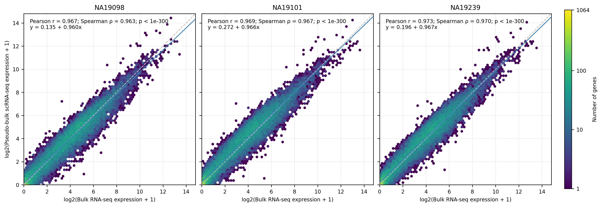

# Bulk–scRNA Concordance

Compare bulk RNA-seq expression with group-level pseudo-bulk profiles from
single-cell RNA-seq. Available as a DSH Host plugin, Python CLI and MCP server
for Claude, ChatGPT and other MCP clients.

The tool reports Pearson and Spearman correlations, a linear regression,
optional group-matching diagnostics, and figures. Each run records parameters,
input/output hashes and package versions.

## Inputs and analysis

- Single-cell raw counts: `.h5ad`, or a genes × cells CSV with cell metadata.
- Bulk expression: a genes × samples CSV/TSV.
- A group label for each cell; bulk sample names must contain the matching
  group as an exact delimited token.

Cells are summed by group, and bulk samples are averaged within each group.
The default normalization is CPM followed by `log2(x+1)`. The regression and
figure use bulk as x and pseudo-bulk as y, with the same genes and transformations.

For `.h5ad`, the default count source is `layers['counts']` when available,
otherwise `X`. Select a layer with `--sc-layer <name>` or explicitly select
`raw.X` with `--sc-use-raw`. Gene metadata follows the selected matrix.
All single-cell inputs must contain raw counts: nonfinite, negative and
non-integer values are rejected. These checks cannot prove that integer-valued
data are untransformed; confirm the source before running.

This is a descriptive comparison. Pooling by group does not estimate biological
replicate variation. The optional matched–mismatched correlation gap can flag
unexpected matches, but does not prove biological agreement.

See [docs/usage.md](docs/usage.md) for parameters, normalization and limitations.

## Requirements

Python with `numpy`, `pandas`, `scipy` and `matplotlib`; `.h5ad` input also
requires `anndata` and `h5py`.

```bash
python -m pip install -r requirements.txt
```

## Real-data example: human iPSC (GSE77288)

This example compares independently measured bulk and single-cell read counts
from three donors in [Tung et al. (2017)](https://doi.org/10.1038/srep39921),
available as [GSE77288](https://www.ncbi.nlm.nih.gov/geo/query/acc.cgi?acc=GSE77288).
It uses the authors' 564 QC-passing cells and eight matching bulk libraries.
The QC list excludes all NA19098.r2 cells, so that batch's bulk library is also
excluded. Both inputs use untransformed read counts; the 92 ERCC spike-in
columns are removed.



| Donor | Cells | Bulk libraries | Genes used | Pearson r | Spearman ρ |
|---|---:|---:|---:|---:|---:|
| NA19098 | 142 | 2 | 15,844 | 0.966628 | 0.963411 |
| NA19101 | 201 | 3 | 16,440 | 0.968652 | 0.967269 |
| NA19239 | 221 | 3 | 16,247 | 0.972792 | 0.970065 |

The figure uses default shared axes, hexagonal gene-density bins, a logarithmic
gene-count colorbar, grid lines, regression lines and per-panel statistics.
The reference run used analysis commit
[`7478bde`](https://github.com/Wanner122333/dsh-bulk-scrna-concordance/commit/7478bdef898cdca66ba05b101f6a5cbfe239035e).
Raw counts and the correlations/regressions were checked independently.

[PDF](examples/gse77288/results/GSE77288_real_bulk_scrna_correlation.pdf) ·
[SVG](examples/gse77288/results/GSE77288_real_bulk_scrna_correlation.svg) ·
[Statistics CSV](examples/gse77288/results/GSE77288_real_bulk_scrna_correlation_stats.csv) ·
[Cross-donor correlations](examples/gse77288/results/GSE77288_real_discriminability.csv) ·
[Results, parameters and source hashes](examples/gse77288/reference_run.json)

From the repository root, prepare the public inputs and run the same analysis:

```bash
python examples/gse77288/prepare.py --out-dir results/gse77288/input-data
python python/bulk_scrna_concordance.py \
  --sc-h5ad results/gse77288/input-data/sc_read_counts.h5ad \
  --bulk-csv results/gse77288/input-data/bulk_read_counts.csv \
  --group-col individual --gene-id-key var_names --discriminability \
  --out-dir results/gse77288 --out-prefix GSE77288_real \
  --results-json results/gse77288/GSE77288_real_results.json
```

The preparation script downloads about 13 MB of compressed counts plus sample
annotations, verifies fixed SHA-256 hashes, and writes raw-count inputs and
provenance. It reuses verified cached downloads on later runs. The underlying
counts are downloaded from their public sources rather than bundled here.
See the [example notes](examples/gse77288/README.md) for filtering, caching and
the reference environment. All three donors are iPSCs: these gene-wise
correlations describe expression agreement, not biological replicate inference
or general classification accuracy. Pearson p-values underflow to zero in the
statistics CSV and display as `p < 1e-300` in the figure.

## Command line

Run the included synthetic fixture:

```bash
python python/bulk_scrna_concordance.py \
  --sc-matrix-csv examples/synthetic/sc_expr.csv \
  --sc-meta-csv examples/synthetic/sc_meta.csv \
  --bulk-csv examples/synthetic/bulk.csv \
  --group-col Group --discriminability \
  --out-dir results --out-prefix example \
  --results-json results/example_results.json
```

For real `.h5ad` data:

```bash
python python/bulk_scrna_concordance.py \
  --sc-h5ad /path/to/counts.h5ad --sc-layer counts \
  --bulk-csv /path/to/bulk.csv --group-col Group \
  --out-dir results --out-prefix my_run \
  --results-json results/my_run_results.json
```

## DSH plugin

Clone the repository:

```bash
git clone https://github.com/Wanner122333/dsh-bulk-scrna-concordance.git
```

In DSH, open **Settings → Plugins** and install the bundle using the absolute
path to the checkout containing `package.json`. The registered tool is
`bulk_scrna_concordance`. Check the installation result and restart DSH if it
reports `restart-required`.

For profiles managed through the CLI:

```bash
dsh plugin --profile <profile> add /absolute/path/to/dsh-bulk-scrna-concordance
```

Set `pythonPath` in the profile's plugin configuration if the required Python
interpreter is not on its `PATH`:

```yaml
- id: bulk-scrna-concordance
  name: "@local/dsh-bulk-scrna-concordance"
  config:
    pythonPath: /absolute/path/to/python
    defaultTimeoutMs: 1800000
    maxLogLines: 40
```

Use the in-app installer for the Desktop-owned profile.

## ChatGPT and Claude through MCP

Install the optional MCP dependencies:

```bash
python -m pip install -r requirements-mcp.txt
python python/mcp_server.py --transport stdio --workspace /path/to/data
```

The server exposes `bulk_scrna_concordance` through stdio for local clients
such as Claude Desktop and Claude Code. Streamable HTTP is also supported.
ChatGPT can connect through Secure MCP Tunnel or an operator-deployed HTTPS
endpoint; account and workspace policies apply. See [MCP setup](docs/mcp.md)
for client configuration and deployment requirements.

Inputs must exist on the server machine. The server returns statistics and
artifact paths; it does not upload chat attachments or serve file downloads.
The HTTP server has no built-in authentication and binds to loopback by
default. Keep it private, or place it behind an authenticated HTTPS proxy.

## Outputs

Files are written under `--out-dir`:

| File | Contents |
|---|---|
| `<prefix>_results.json` | Parameters, per-group statistics, diagnostics and warnings; CLI requires `--results-json` |
| `<prefix>_bulk_scrna_correlation_stats.csv` | Per-group statistics |
| `<prefix>_discriminability.csv` | Pseudo-bulk × bulk correlation matrix, when requested |
| `<prefix>_bulk_scrna_correlation.{png,pdf,svg}` | Scatter plots with regression and y=x lines |
| `<prefix>_manifest.json` | Code/input/output hashes and recorded environment versions |
| `<prefix>_run.log` | Analysis log when called through DSH or MCP |

The manifest's `environment_lock` field records installed versions; it is not
an installable dependency lockfile.

## Checks

```bash
python -m unittest discover -s tests -v
node --check index.js
```

These synthetic regression checks cover input handling and numerical behavior.
They do not establish biological validity or confirm an installed host's setup.

